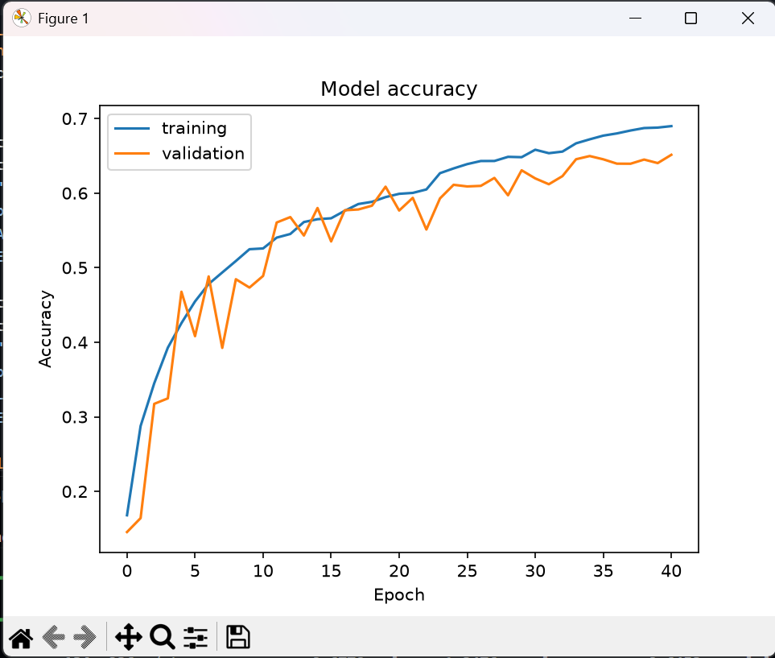
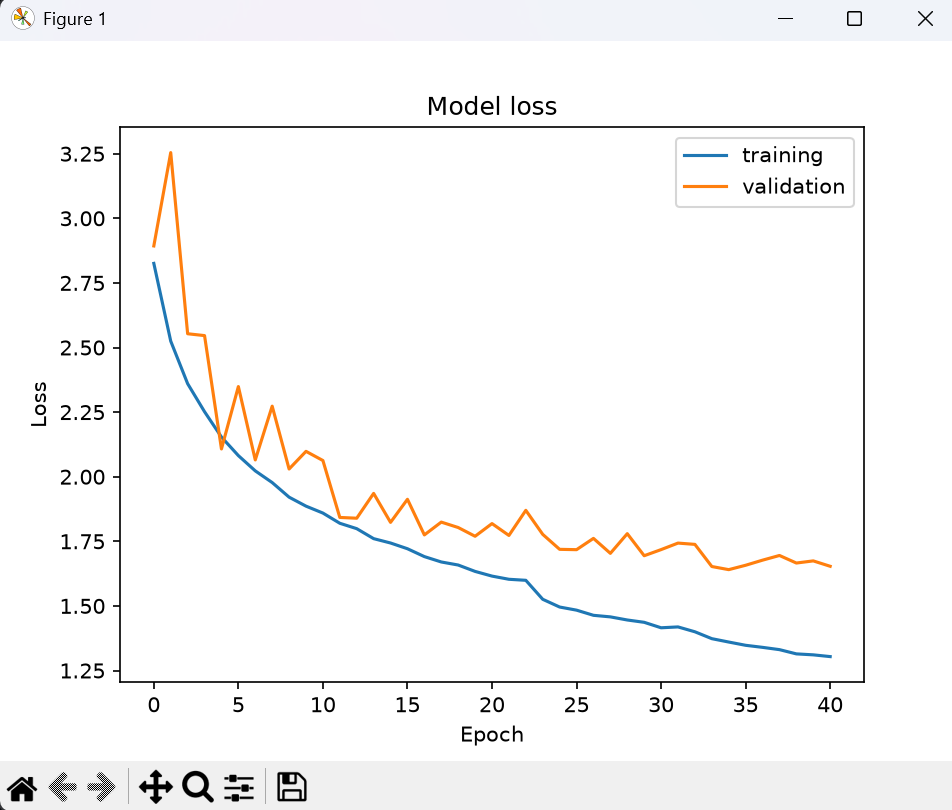
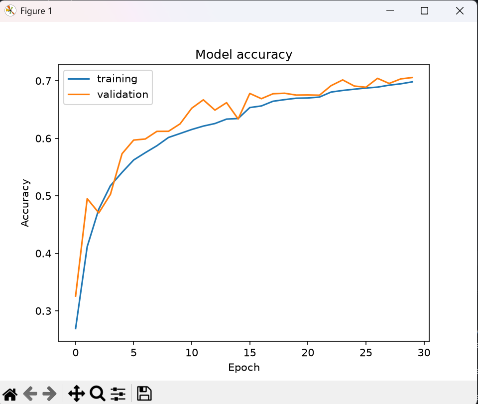
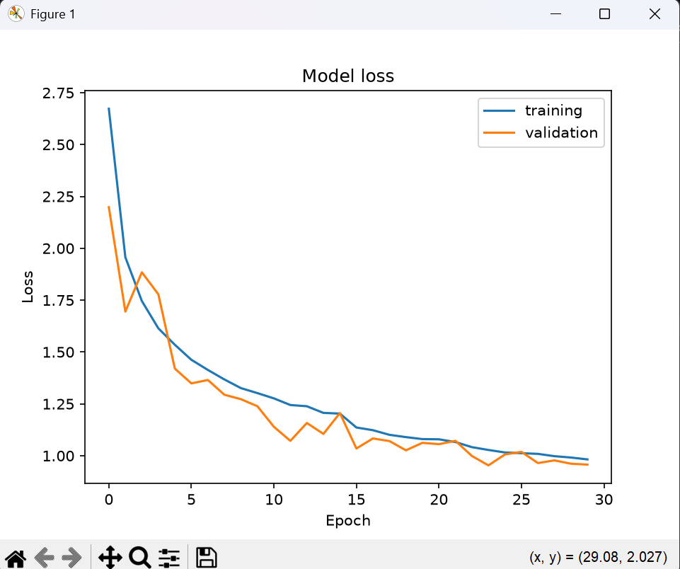

### Links to my LLM chats:
- https://claude.ai/share/1577e5f3-7a02-4538-a5ce-40ed4b0b422b
- https://claude.ai/share/70c5192f-f7e4-4298-bb7a-7b691b405c7d
- https://chatgpt.com/share/6af3225c-4610-83eb-9c11-e19505e5a6f5


## Model Architecture

**Model:** `sequential`

| Layer (Type) | Output Shape | Param # |
|---|---|---:|
| conv2d (Conv2D) | `(None, 32, 32, 32)` | 320 |
| batch_normalization (BatchNormalization) | `(None, 32, 32, 32)` | 128 |
| conv2d_1 (Conv2D) | `(None, 32, 32, 32)` | 9,248 |
| batch_normalization_1 (BatchNormalization) | `(None, 32, 32, 32)` | 128 |
| max_pooling2d (MaxPooling2D) | `(None, 16, 16, 32)` | 0 |
| dropout (Dropout) | `(None, 16, 16, 32)` | 0 |
| conv2d_2 (Conv2D) | `(None, 16, 16, 64)` | 18,496 |
| batch_normalization_2 (BatchNormalization) | `(None, 16, 16, 64)` | 256 |
| conv2d_3 (Conv2D) | `(None, 16, 16, 64)` | 36,928 |
| batch_normalization_3 (BatchNormalization) | `(None, 16, 16, 64)` | 256 |
| max_pooling2d_1 (MaxPooling2D) | `(None, 8, 8, 64)` | 0 |
| dropout_1 (Dropout) | `(None, 8, 8, 64)` | 0 |
| conv2d_4 (Conv2D) | `(None, 8, 8, 128)` | 73,856 |
| batch_normalization_4 (BatchNormalization) | `(None, 8, 8, 128)` | 512 |
| conv2d_5 (Conv2D) | `(None, 8, 8, 128)` | 147,584 |
| batch_normalization_5 (BatchNormalization) | `(None, 8, 8, 128)` | 512 |
| max_pooling2d_2 (MaxPooling2D) | `(None, 4, 4, 128)` | 0 |
| dropout_2 (Dropout) | `(None, 4, 4, 128)` | 0 |
| flatten (Flatten) | `(None, 2048)` | 0 |
| dense (Dense) | `(None, 256)` | 524,544 |
| batch_normalization_6 (BatchNormalization) | `(None, 256)` | 1,024 |
| dropout_3 (Dropout) | `(None, 256)` | 0 |
| dense_1 (Dense) | `(None, 24)` | 6,168 |

### Model Parameters

| Parameter | Value |
|---|---:|
| Total Parameters | 819,960 (3.13 MB) |
| Trainable Parameters | 818,552 (3.12 MB) |
| Non-trainable Parameters | 1,408 (5.50 KB) |

## Training History

- **Total planned epochs:** 60
- **Completed epochs:** 54
- **Steps per epoch:** 569

| Epoch | Accuracy | Loss | Val Accuracy | Val Loss | Learning Rate |
|---:|---:|---:|---:|---:|---:|
| 1 | 0.2682 | 2.6620 | 0.3613 | 2.1099 | 0.0010 |
| 2 | 0.4007 | 2.0006 | 0.4255 | 1.9824 | 0.0010 |
| 3 | 0.4654 | 1.7844 | 0.5446 | 1.5336 | 0.0010 |
| 4 | 0.5030 | 1.6592 | 0.5520 | 1.4962 | 0.0010 |
| 5 | 0.5299 | 1.5679 | 0.5527 | 1.4836 | 0.0010 |
| 6 | 0.5498 | 1.5042 | 0.5020 | 1.6632 | 0.0010 |
| 7 | 0.5644 | 1.4522 | 0.5814 | 1.4028 | 0.0010 |
| 8 | 0.5729 | 1.4191 | 0.5433 | 1.5143 | 0.0010 |
| 9 | 0.5841 | 1.3830 | 0.6365 | 1.1819 | 0.0010 |
| 10 | 0.5957 | 1.3493 | 0.6103 | 1.3125 | 0.0010 |
| 11 | 0.6039 | 1.3233 | 0.6331 | 1.1978 | 0.0010 |
| 12 | 0.6062 | 1.2979 | 0.6163 | 1.2412 | 0.0010 |
| 13 | 0.6233 | 1.2457 | 0.6423 | 1.1812 | 0.0005 |
| 14 | 0.6335 | 1.2146 | 0.6721 | 1.0537 | 0.0005 |
| 15 | 0.6380 | 1.1963 | 0.6664 | 1.0799 | 0.0005 |
| 16 | 0.6430 | 1.1769 | 0.6662 | 1.0558 | 0.0005 |
| 17 | 0.6450 | 1.1652 | 0.6876 | 0.9932 | 0.0005 |
| 18 | 0.6485 | 1.1573 | 0.6671 | 1.0854 | 0.0005 |
| 19 | 0.6504 | 1.1519 | 0.6653 | 1.0920 | 0.0005 |
| 20 | 0.6513 | 1.1395 | 0.6741 | 1.0466 | 0.0005 |
| 21 | 0.6632 | 1.1005 | 0.6819 | 1.0278 | 0.00025 |
| 22 | 0.6633 | 1.0921 | 0.6943 | 0.9782 | 0.00025 |
| 23 | 0.6662 | 1.0863 | 0.6945 | 0.9718 | 0.00025 |
| 24 | 0.6679 | 1.0830 | 0.6852 | 1.0105 | 0.00025 |
| 25 | 0.6719 | 1.0681 | 0.6821 | 1.0274 | 0.00025 |
| 26 | 0.6704 | 1.0676 | 0.6898 | 1.0005 | 0.00025 |
| 27 | 0.6758 | 1.0563 | 0.6996 | 0.9678 | 0.000125 |
| 28 | 0.6792 | 1.0436 | 0.6880 | 1.0080 | 0.000125 |
| 29 | 0.6793 | 1.0433 | 0.7032 | 0.9547 | 0.000125 |
| 30 | 0.6782 | 1.0411 | 0.7015 | 0.9488 | 0.000125 |
| 31 | 0.6802 | 1.0373 | 0.6975 | 0.9626 | 0.000125 |
| 32 | 0.6806 | 1.0344 | 0.6984 | 0.9703 | 0.000125 |
| 33 | 0.6856 | 1.0281 | 0.6954 | 0.9708 | 0.000125 |
| 34 | 0.6879 | 1.0188 | 0.7067 | 0.9401 | 0.0000625 |
| 35 | 0.6857 | 1.0235 | 0.7057 | 0.9464 | 0.0000625 |
| 36 | 0.6871 | 1.0155 | 0.7014 | 0.9589 | 0.0000625 |
| 37 | 0.6868 | 1.0161 | 0.7068 | 0.9383 | 0.0000625 |
| 38 | 0.6868 | 1.0156 | 0.7073 | 0.9369 | 0.0000625 |
| 39 | 0.6879 | 1.0129 | 0.7075 | 0.9317 | 0.0000625 |
| 40 | 0.6902 | 1.0029 | 0.7049 | 0.9438 | 0.0000625 |
| 41 | 0.6890 | 1.0096 | 0.7036 | 0.9455 | 0.0000625 |
| 42 | 0.6912 | 1.0036 | 0.7052 | 0.9395 | 0.0000625 |
| 43 | 0.6910 | 1.0052 | 0.7064 | 0.9399 | 0.00003125 |
| 44 | 0.6934 | 1.0006 | 0.7068 | 0.9329 | 0.00003125 |
| 45 | 0.6893 | 1.0035 | 0.7068 | 0.9315 | 0.00003125 |
| 46 | 0.6902 | 0.9999 | 0.7096 | 0.9220 | 0.00003125 |
| 47 | 0.6914 | 1.0018 | 0.7075 | 0.9290 | 0.00003125 |
| 48 | 0.6904 | 1.0019 | 0.7091 | 0.9237 | 0.00003125 |
| 49 | 0.6911 | 1.0008 | 0.7109 | 0.9258 | 0.00003125 |
| 50 | 0.6912 | 0.9978 | 0.7105 | 0.9269 | 0.000015625 |
| 51 | 0.6935 | 0.9886 | 0.7112 | 0.9272 | 0.000015625 |
| 52 | 0.6908 | 0.9953 | 0.7086 | 0.9312 | 0.000015625 |
| 53 | 0.6926 | 0.9966 | 0.7084 | 0.9299 | 0.0000078125 |
| 54 | 0.6923 | 0.9954 | 0.7084 | 0.9317 | 0.0000078125 |

## Test Results

**Evaluation steps:** 285

| Metric | Value |
|---|---:|
| Test Loss | 0.9215 |
| Test Accuracy | 0.7143 (71.43%) |

### Raw Evaluation Output

```text
285/285 ━━━━━━━━━━━━━━━━━━━━ 3s 11ms/step - accuracy: 0.7143 - loss: 0.9215

Test Score: 0.9215359687805176
Test Accuracy: 0.7142857313156128
```

**Note:** Training completed 54 out of the planned 60 epochs. The reason for stopping is not specified in the original output.

```
def evaluate_model(model, X_train, y_train, X_val, y_val, X_test, y_test, datagen):
  datagen.fit(X_train)

  callbacks = [
    EarlyStopping(monitor='val_loss', patience=8, restore_best_weights=True),
    ReduceLROnPlateau(monitor='val_loss', factor=0.5, patience=3, min_lr=1e-6)
  ]

  history = model.fit(
    datagen.flow(X_train, y_train, batch_size=64), 
    epochs=60, 
    validation_data=(X_val, y_val), 
    verbose=1, 
    shuffle=1,
    callbacks=callbacks
  )
  plt.plot(history.history['accuracy'])
  plt.plot(history.history['val_accuracy'])
  plt.legend(["training", "validation"])
  plt.title('Model accuracy')
  plt.ylabel('Accuracy')
  plt.xlabel('Epoch')
  plt.show()
  plt.plot(history.history['loss'])
  plt.plot(history.history['val_loss'])
  plt.legend(["training", "validation"])
  plt.title('Model loss')
  plt.ylabel('Loss')
  plt.xlabel('Epoch')
  plt.show()
  score = model.evaluate(X_test, y_test, verbose=1)
  print("Test Score:", score[0])
  print("Test Accuracy:", score[1])


def modified_model(num_classes):
  model = Sequential([
    Input(shape=(32, 32, 1)),

    Conv2D(32, (3, 3), padding="same", activation="relu"),
    BatchNormalization(),
    Conv2D(32, (3, 3), padding="same", activation="relu"),
    BatchNormalization(),
    MaxPooling2D((2, 2)),
    Dropout(0.25),

    Conv2D(64, (3, 3), padding="same", activation="relu"),
    BatchNormalization(),
    Conv2D(64, (3, 3), padding="same", activation="relu"),
    BatchNormalization(),
    MaxPooling2D((2, 2)),
    Dropout(0.3),

    Conv2D(128, (3, 3), padding="same", activation="relu"),
    BatchNormalization(),
    Conv2D(128, (3, 3), padding="same", activation="relu"),
    BatchNormalization(),
    MaxPooling2D((2, 2)),
    Dropout(0.4),

    Flatten(),
    Dense(256, activation="relu"),
    BatchNormalization(),
    Dropout(0.5),
    Dense(num_classes, activation="softmax"),
  ])
  model.compile(Adam(learning_rate=0.001), loss="categorical_crossentropy", metrics=["accuracy"])
  return model
```

# Third Model




## Model Architecture

**Model:** `sequential`

| Layer (Type) | Output Shape | Param # |
|---|---|---:|
| conv2d (Conv2D) | `(None, 32, 32, 64)` | 640 |
| batch_normalization (BatchNormalization) | `(None, 32, 32, 64)` | 256 |
| conv2d_1 (Conv2D) | `(None, 32, 32, 64)` | 36,928 |
| batch_normalization_1 (BatchNormalization) | `(None, 32, 32, 64)` | 256 |
| max_pooling2d (MaxPooling2D) | `(None, 16, 16, 64)` | 0 |
| dropout (Dropout) | `(None, 16, 16, 64)` | 0 |
| conv2d_2 (Conv2D) | `(None, 16, 16, 128)` | 73,856 |
| batch_normalization_2 (BatchNormalization) | `(None, 16, 16, 128)` | 512 |
| conv2d_3 (Conv2D) | `(None, 16, 16, 128)` | 147,584 |
| batch_normalization_3 (BatchNormalization) | `(None, 16, 16, 128)` | 512 |
| max_pooling2d_1 (MaxPooling2D) | `(None, 8, 8, 128)` | 0 |
| dropout_1 (Dropout) | `(None, 8, 8, 128)` | 0 |
| conv2d_4 (Conv2D) | `(None, 8, 8, 256)` | 295,168 |
| batch_normalization_4 (BatchNormalization) | `(None, 8, 8, 256)` | 1,024 |
| conv2d_5 (Conv2D) | `(None, 8, 8, 256)` | 590,080 |
| batch_normalization_5 (BatchNormalization) | `(None, 8, 8, 256)` | 1,024 |
| global_average_pooling2d (GlobalAveragePooling2D) | `(None, 256)` | 0 |
| dropout_2 (Dropout) | `(None, 256)` | 0 |
| dense (Dense) | `(None, 24)` | 6,168 |

### Model Parameters

| Parameter | Value |
|---|---:|
| Total Parameters | 1,154,008 (4.40 MB) |
| Trainable Parameters | 1,152,216 (4.40 MB) |
| Non-trainable Parameters | 1,792 (7.00 KB) |

## Training History

- **Total epochs:** 54
- **Steps per epoch:** 569

| Epoch | Accuracy | Loss | Val Accuracy | Val Loss | Learning Rate |
|---:|---:|---:|---:|---:|---:|
| 1 | 0.1680 | 2.8255 | 0.1455 | 2.8931 | 0.0010 |
| 2 | 0.2877 | 2.5247 | 0.1642 | 3.2543 | 0.0010 |
| 3 | 0.3449 | 2.3601 | 0.3174 | 2.5533 | 0.0010 |
| 4 | 0.3927 | 2.2515 | 0.3247 | 2.5461 | 0.0010 |
| 5 | 0.4256 | 2.1536 | 0.4677 | 2.1074 | 0.0010 |
| 6 | 0.4548 | 2.0817 | 0.4081 | 2.3489 | 0.0010 |
| 7 | 0.4781 | 2.0226 | 0.4882 | 2.0650 | 0.0010 |
| 8 | 0.4935 | 1.9774 | 0.3924 | 2.2730 | 0.0010 |
| 9 | 0.5089 | 1.9209 | 0.4845 | 2.0298 | 0.0010 |
| 10 | 0.5247 | 1.8861 | 0.4733 | 2.0981 | 0.0010 |
| 11 | 0.5258 | 1.8593 | 0.4889 | 2.0626 | 0.0010 |
| 12 | 0.5403 | 1.8198 | 0.5605 | 1.8424 | 0.0010 |
| 13 | 0.5452 | 1.7990 | 0.5678 | 1.8394 | 0.0010 |
| 14 | 0.5612 | 1.7603 | 0.5431 | 1.9354 | 0.0010 |
| 15 | 0.5650 | 1.7435 | 0.5800 | 1.8233 | 0.0010 |
| 16 | 0.5662 | 1.7213 | 0.5352 | 1.9126 | 0.0010 |
| 17 | 0.5762 | 1.6909 | 0.5769 | 1.7748 | 0.0010 |
| 18 | 0.5853 | 1.6701 | 0.5780 | 1.8243 | 0.0010 |
| 19 | 0.5883 | 1.6582 | 0.5831 | 1.8034 | 0.0010 |
| 20 | 0.5946 | 1.6335 | 0.6086 | 1.7695 | 0.0010 |
| 21 | 0.5990 | 1.6154 | 0.5766 | 1.8186 | 0.0010 |
| 22 | 0.6002 | 1.6031 | 0.5936 | 1.7727 | 0.0010 |
| 23 | 0.6049 | 1.5991 | 0.5511 | 1.8699 | 0.0010 |
| 24 | 0.6267 | 1.5256 | 0.5929 | 1.7769 | 0.0005 |
| 25 | 0.6331 | 1.4957 | 0.6111 | 1.7189 | 0.0005 |
| 26 | 0.6388 | 1.4836 | 0.6089 | 1.7177 | 0.0005 |
| 27 | 0.6430 | 1.4636 | 0.6097 | 1.7613 | 0.0005 |
| 28 | 0.6430 | 1.4576 | 0.6203 | 1.7034 | 0.0005 |
| 29 | 0.6486 | 1.4455 | 0.5970 | 1.7796 | 0.0005 |
| 30 | 0.6481 | 1.4365 | 0.6305 | 1.6942 | 0.0005 |
| 31 | 0.6581 | 1.4154 | 0.6197 | 1.7179 | 0.0005 |
| 32 | 0.6535 | 1.4187 | 0.6119 | 1.7431 | 0.0005 |
| 33 | 0.6556 | 1.3999 | 0.6227 | 1.7382 | 0.0005 |
| 34 | 0.6667 | 1.3732 | 0.6454 | 1.6524 | 0.00025 |
| 35 | 0.6721 | 1.3602 | 0.6497 | 1.6404 | 0.00025 |
| 36 | 0.6770 | 1.3476 | 0.6453 | 1.6573 | 0.00025 |
| 37 | 0.6800 | 1.3396 | 0.6395 | 1.6771 | 0.00025 |
| 38 | 0.6839 | 1.3308 | 0.6393 | 1.6952 | 0.00025 |
| 39 | 0.6872 | 1.3144 | 0.6449 | 1.6659 | 0.000125 |
| 40 | 0.6878 | 1.3106 | 0.6402 | 1.6742 | 0.000125 |
| 41 | 0.6898 | 1.3039 | 0.6513 | 1.6534 | 0.000125 |

## Test Results

**Evaluation steps:** 285

| Metric | Value |
|---|---:|
| Test Loss | 1.6456 |
| Test Accuracy | 0.6455 (64.55%) |

### Classification Report

| Class | Precision | Recall | F1-Score | Support |
|---|---:|---:|---:|---:|
| automobile | 0.93 | 0.82 | 0.87 | 1000 |
| bird | 0.67 | 0.70 | 0.68 | 1000 |
| cat | 0.75 | 0.43 | 0.55 | 1000 |
| deer | 0.75 | 0.63 | 0.69 | 1000 |
| dog | 0.83 | 0.47 | 0.60 | 1000 |
| horse | 0.89 | 0.70 | 0.78 | 1000 |
| truck | 0.89 | 0.77 | 0.82 | 1000 |
| cattle | 0.25 | 0.55 | 0.34 | 100 |
| fox | 0.23 | 0.55 | 0.33 | 100 |
| baby | 0.35 | 0.54 | 0.42 | 100 |
| boy | 0.27 | 0.38 | 0.31 | 100 |
| girl | 0.28 | 0.29 | 0.28 | 100 |
| man | 0.32 | 0.34 | 0.33 | 100 |
| woman | 0.32 | 0.33 | 0.33 | 100 |
| rabbit | 0.14 | 0.44 | 0.22 | 100 |
| squirrel | 0.21 | 0.39 | 0.27 | 100 |
| bicycle | 0.36 | 0.95 | 0.52 | 100 |
| bus | 0.32 | 0.42 | 0.36 | 100 |
| motorcycle | 0.37 | 0.82 | 0.51 | 100 |
| pickup_truck | 0.43 | 0.60 | 0.50 | 100 |
| train | 0.52 | 0.77 | 0.62 | 100 |
| lawn_mower | 0.30 | 0.84 | 0.44 | 100 |
| tractor | 0.32 | 0.71 | 0.44 | 100 |
| tree | 0.82 | 0.91 | 0.86 | 500 |
| **Accuracy** | | | **0.65** | **9100** |
| **Macro Average** | **0.48** | **0.60** | **0.50** | **9100** |
| **Weighted Average** | **0.73** | **0.65** | **0.67** | **9100** |

### Raw Evaluation Output

```text
285/285 ━━━━━━━━━━━━━━━━━━━━ 9s 33ms/step - accuracy: 0.6455 - loss: 1.6456

Test Score: 1.6455565690994263
Test Accuracy: 0.6454945206642151
```

```
def evaluate_model(model, X_train, y_train, X_val, y_val, X_test, y_test, datagen, class_names):
  datagen.fit(X_train)

  labels = np.argmax(y_train, axis=1)
  weights = compute_class_weight("balanced", classes=np.arange(y_train.shape[1]), y=labels)
  class_weight = dict(enumerate(weights))

  callbacks = [
    EarlyStopping(monitor="val_loss", patience=6, restore_best_weights=True),
    ReduceLROnPlateau(monitor="val_loss", factor=0.5, patience=3, min_lr=1e-6),
    ModelCheckpoint("best_model.keras", monitor="val_loss", save_best_only=True),
  ]

  history = model.fit(
    datagen.flow(X_train, y_train, batch_size=64),
    epochs=54,
    validation_data=(X_val, y_val),
    class_weight=class_weight,
    callbacks=callbacks,
    verbose=1,
  )
  plt.plot(history.history['accuracy'])
  plt.plot(history.history['val_accuracy'])
  plt.legend(["training", "validation"])
  plt.title('Model accuracy')
  plt.ylabel('Accuracy')
  plt.xlabel('Epoch')
  plt.show()
  plt.plot(history.history['loss'])
  plt.plot(history.history['val_loss'])
  plt.legend(["training", "validation"])
  plt.title('Model loss')
  plt.ylabel('Loss')
  plt.xlabel('Epoch')
  plt.show()
  score = model.evaluate(X_test, y_test, verbose=1)
  print("Test Score:", score[0])
  print("Test Accuracy:", score[1])
  y_pred = np.argmax(model.predict(X_test), axis=1)
  y_true = np.argmax(y_test, axis=1)
  print(classification_report(y_true, y_pred, target_names=class_names))
  

def modified_model(num_classes):
  model = Sequential([
    Input(shape=(32, 32, 1)),

    Conv2D(64, (3, 3), padding="same", activation="relu"),
    BatchNormalization(),
    Conv2D(64, (3, 3), padding="same", activation="relu"),
    BatchNormalization(),
    MaxPooling2D((2, 2)),
    Dropout(0.2),

    Conv2D(128, (3, 3), padding="same", activation="relu"),
    BatchNormalization(),
    Conv2D(128, (3, 3), padding="same", activation="relu"),
    BatchNormalization(),
    MaxPooling2D((2, 2)),
    Dropout(0.3),

    Conv2D(256, (3, 3), padding="same", activation="relu"),
    BatchNormalization(),
    Conv2D(256, (3, 3), padding="same", activation="relu"),
    BatchNormalization(),
    GlobalAveragePooling2D(),     # replaces Flatten + Dense(256)
    Dropout(0.4),

    Dense(num_classes, activation="softmax"),
  ])
  model.compile(
    Adam(learning_rate=0.001),
    loss=CategoricalCrossentropy(label_smoothing=0.1),
    metrics=["accuracy"],
  )
  return model
```

# Fourth Model




# Model Architecture and Training Results

## Model Summary

**Model:** Sequential

| Layer | Output Shape | Parameters |
|---|---|---:|
| Conv2D | (None, 32, 32, 32) | 320 |
| BatchNormalization | (None, 32, 32, 32) | 128 |
| Conv2D | (None, 32, 32, 32) | 9,248 |
| BatchNormalization | (None, 32, 32, 32) | 128 |
| MaxPooling2D | (None, 16, 16, 32) | 0 |
| Dropout | (None, 16, 16, 32) | 0 |
| Conv2D | (None, 16, 16, 64) | 18,496 |
| BatchNormalization | (None, 16, 16, 64) | 256 |
| Conv2D | (None, 16, 16, 64) | 36,928 |
| BatchNormalization | (None, 16, 16, 64) | 256 |
| MaxPooling2D | (None, 8, 8, 64) | 0 |
| Dropout | (None, 8, 8, 64) | 0 |
| Conv2D | (None, 8, 8, 128) | 73,856 |
| BatchNormalization | (None, 8, 8, 128) | 512 |
| Conv2D | (None, 8, 8, 128) | 147,584 |
| BatchNormalization | (None, 8, 8, 128) | 512 |
| MaxPooling2D | (None, 4, 4, 128) | 0 |
| Dropout | (None, 4, 4, 128) | 0 |
| Flatten | (None, 2048) | 0 |
| Dense | (None, 256) | 524,544 |
| BatchNormalization | (None, 256) | 1,024 |
| Dropout | (None, 256) | 0 |
| Dense (Output) | (None, 24) | 6,168 |

### Parameter Counts

| Parameter Type | Count |
|---|---:|
| Total parameters | 819,960 |
| Trainable parameters | 818,552 |
| Non-trainable parameters | 1,408 |

- Total model size: 3.13 MB
- Trainable parameters size: 3.12 MB
- Non-trainable parameters size: 5.50 KB

---

## Training Configuration and History

- Configured epochs: 54
- Epoch records included in the supplied log: 30
- Steps per epoch: 569

| Epoch | Accuracy | Loss | Validation Accuracy | Validation Loss | Learning Rate |
|---:|---:|---:|---:|---:|---:|
| 1 | 0.2691 | 2.6728 | 0.3256 | 2.1979 | 0.0010 |
| 2 | 0.4116 | 1.9567 | 0.4951 | 1.6949 | 0.0010 |
| 3 | 0.4769 | 1.7459 | 0.4703 | 1.8843 | 0.0010 |
| 4 | 0.5176 | 1.6142 | 0.5025 | 1.7782 | 0.0010 |
| 5 | 0.5407 | 1.5349 | 0.5732 | 1.4200 | 0.0010 |
| 6 | 0.5623 | 1.4625 | 0.5969 | 1.3488 | 0.0010 |
| 7 | 0.5750 | 1.4136 | 0.5988 | 1.3651 | 0.0010 |
| 8 | 0.5870 | 1.3677 | 0.6121 | 1.2939 | 0.0010 |
| 9 | 0.6015 | 1.3260 | 0.6122 | 1.2726 | 0.0010 |
| 10 | 0.6084 | 1.3019 | 0.6252 | 1.2387 | 0.0010 |
| 11 | 0.6153 | 1.2765 | 0.6523 | 1.1395 | 0.0010 |
| 12 | 0.6213 | 1.2445 | 0.6669 | 1.0717 | 0.0010 |
| 13 | 0.6257 | 1.2385 | 0.6490 | 1.1579 | 0.0010 |
| 14 | 0.6334 | 1.2066 | 0.6620 | 1.1052 | 0.0010 |
| 15 | 0.6344 | 1.2031 | 0.6336 | 1.2056 | 0.0010 |
| 16 | 0.6535 | 1.1361 | 0.6780 | 1.0349 | 0.0005 |
| 17 | 0.6563 | 1.1231 | 0.6689 | 1.0833 | 0.0005 |
| 18 | 0.6644 | 1.1008 | 0.6775 | 1.0707 | 0.0005 |
| 19 | 0.6673 | 1.0897 | 0.6784 | 1.0262 | 0.0005 |
| 20 | 0.6697 | 1.0802 | 0.6752 | 1.0622 | 0.0005 |
| 21 | 0.6701 | 1.0792 | 0.6754 | 1.0557 | 0.0005 |
| 22 | 0.6717 | 1.0660 | 0.6749 | 1.0719 | 0.0005 |
| 23 | 0.6804 | 1.0414 | 0.6915 | 0.9988 | 0.00025 |
| 24 | 0.6832 | 1.0278 | 0.7015 | 0.9534 | 0.00025 |
| 25 | 0.6854 | 1.0158 | 0.6909 | 1.0061 | 0.00025 |
| 26 | 0.6874 | 1.0122 | 0.6888 | 1.0186 | 0.00025 |
| 27 | 0.6890 | 1.0090 | 0.7043 | 0.9647 | 0.00025 |
| 28 | 0.6924 | 0.9979 | 0.6954 | 0.9775 | 0.000125 |
| 29 | 0.6948 | 0.9913 | 0.7033 | 0.9615 | 0.000125 |
| 30 | 0.6982 | 0.9823 | 0.7057 | 0.9572 | 0.000125 |

---

## Test Evaluation

| Metric | Result |
|---|---:|
| Test Loss | 0.9561 |
| Test Accuracy | 0.6971 |
| Test Samples | 9,100 |

**Test Score:** 0.9561377763748169  
**Test Accuracy:** 69.71%

---

## Classification Report

| Class | Precision | Recall | F1-Score | Support |
|---|---:|---:|---:|---:|
| automobile | 0.86 | 0.94 | 0.90 | 1000 |
| bird | 0.54 | 0.85 | 0.66 | 1000 |
| cat | 0.66 | 0.55 | 0.60 | 1000 |
| deer | 0.65 | 0.76 | 0.70 | 1000 |
| dog | 0.72 | 0.63 | 0.67 | 1000 |
| horse | 0.83 | 0.81 | 0.82 | 1000 |
| truck | 0.79 | 0.90 | 0.84 | 1000 |
| cattle | 0.50 | 0.06 | 0.11 | 100 |
| fox | 0.40 | 0.02 | 0.04 | 100 |
| baby | 0.44 | 0.17 | 0.24 | 100 |
| boy | 0.29 | 0.28 | 0.29 | 100 |
| girl | 0.50 | 0.08 | 0.14 | 100 |
| man | 0.36 | 0.24 | 0.29 | 100 |
| woman | 0.26 | 0.14 | 0.18 | 100 |
| rabbit | 0.00 | 0.00 | 0.00 | 100 |
| squirrel | 0.50 | 0.06 | 0.11 | 100 |
| bicycle | 0.59 | 0.76 | 0.67 | 100 |
| bus | 0.70 | 0.16 | 0.26 | 100 |
| motorcycle | 0.56 | 0.83 | 0.67 | 100 |
| pickup_truck | 0.70 | 0.14 | 0.23 | 100 |
| train | 0.73 | 0.48 | 0.58 | 100 |
| lawn_mower | 0.62 | 0.65 | 0.64 | 100 |
| tractor | 0.53 | 0.35 | 0.42 | 100 |
| tree | 0.78 | 0.92 | 0.85 | 500 |

### Overall Classification Metrics

| Metric | Precision | Recall | F1-Score | Support |
|---|---:|---:|---:|---:|
| Accuracy | — | — | 0.70 | 9100 |
| Macro Average | 0.56 | 0.45 | 0.45 | 9100 |
| Weighted Average | 0.68 | 0.70 | 0.67 | 9100 |

---

## Summary

- The model contains approximately **820K parameters**.
- It uses convolutional layers, batch normalization, max pooling, dropout, and dense layers.
- The best validation accuracy in the supplied epoch records was **70.57% at epoch 30**.
- The final reported test accuracy was **69.71%**.
- The classification report shows stronger performance for classes such as automobile, horse, truck, and tree.
- Some minority classes, including rabbit, fox, and cattle, have notably lower recall.

**Note:** The training output identifies a 54-epoch configuration, but only epochs 1–30 are included in the supplied log.


```
def evaluate_model(model, X_train, y_train, X_val, y_val, X_test, y_test, datagen, class_names):
  datagen.fit(X_train)

  callbacks = [
    EarlyStopping(monitor="val_loss", patience=6, restore_best_weights=True),
    ReduceLROnPlateau(monitor="val_loss", factor=0.5, patience=3, min_lr=1e-6),
    ModelCheckpoint("best_model.keras", monitor="val_loss", save_best_only=True),
  ]

  history = model.fit(
    datagen.flow(X_train, y_train, batch_size=64),
    epochs=54,
    validation_data=(X_val, y_val),
    callbacks=callbacks,
    verbose=1,
  )
  plt.plot(history.history['accuracy'])
  plt.plot(history.history['val_accuracy'])
  plt.legend(["training", "validation"])
  plt.title('Model accuracy')
  plt.ylabel('Accuracy')
  plt.xlabel('Epoch')
  plt.show()
  plt.plot(history.history['loss'])
  plt.plot(history.history['val_loss'])
  plt.legend(["training", "validation"])
  plt.title('Model loss')
  plt.ylabel('Loss')
  plt.xlabel('Epoch')
  plt.show()
  score = model.evaluate(X_test, y_test, verbose=1)
  print("Test Score:", score[0])
  print("Test Accuracy:", score[1])
  y_pred = np.argmax(model.predict(X_test), axis=1)
  y_true = np.argmax(y_test, axis=1)
  print(classification_report(y_true, y_pred, target_names=class_names))
  

def modified_model(num_classes):
  model = Sequential([
    Input(shape=(32, 32, 1)),

    Conv2D(32, (3, 3), padding="same", activation="relu"),
    BatchNormalization(),
    Conv2D(32, (3, 3), padding="same", activation="relu"),
    BatchNormalization(),
    MaxPooling2D((2, 2)),
    Dropout(0.25),

    Conv2D(64, (3, 3), padding="same", activation="relu"),
    BatchNormalization(),
    Conv2D(64, (3, 3), padding="same", activation="relu"),
    BatchNormalization(),
    MaxPooling2D((2, 2)),
    Dropout(0.3),

    Conv2D(128, (3, 3), padding="same", activation="relu"),
    BatchNormalization(),
    Conv2D(128, (3, 3), padding="same", activation="relu"),
    BatchNormalization(),
    MaxPooling2D((2, 2)),
    Dropout(0.4),

    Flatten(),
    Dense(256, activation="relu"),
    BatchNormalization(),
    Dropout(0.5),
    Dense(num_classes, activation="softmax"),
  ])
  model.compile(Adam(learning_rate=0.001), loss="categorical_crossentropy", metrics=["accuracy"])
  return model
```