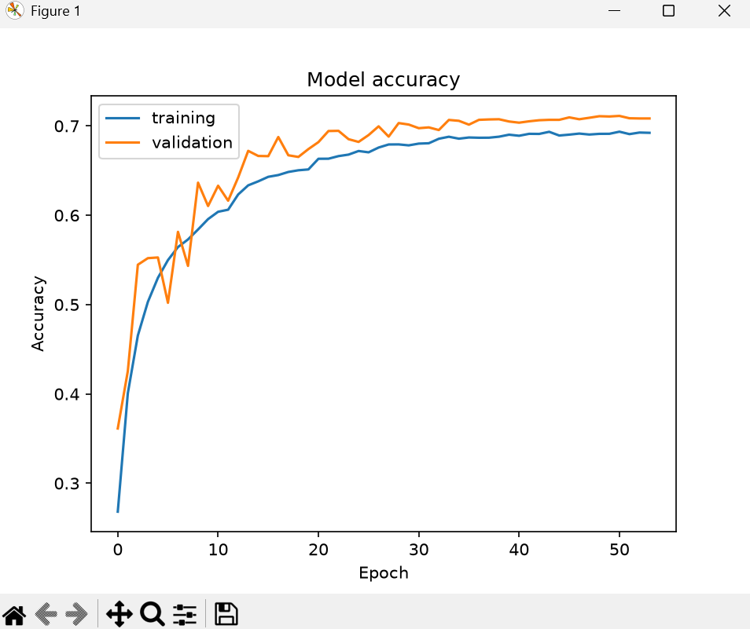
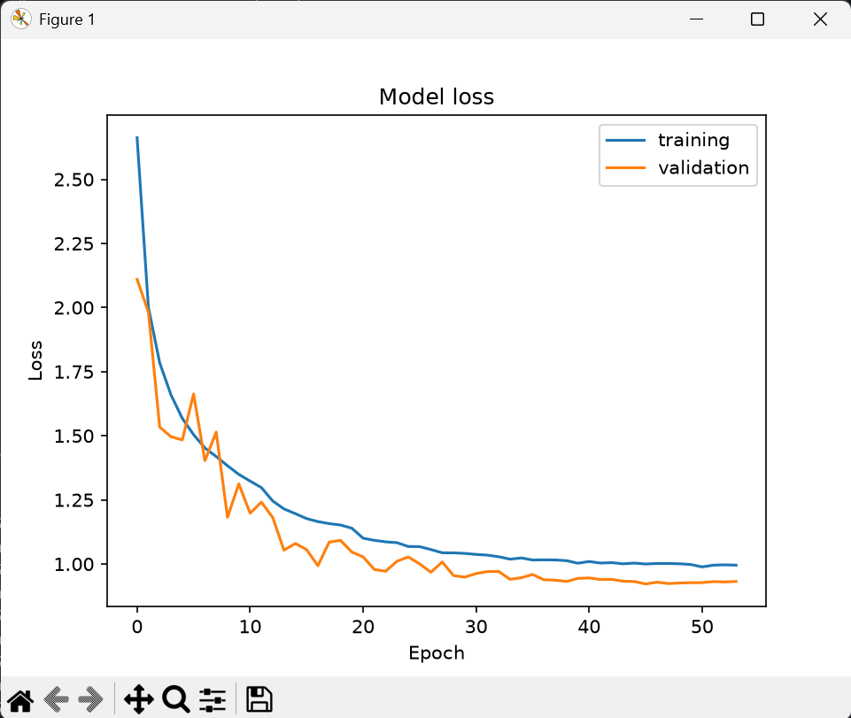

### Links to my LLM chats:
- https://claude.ai/share/1577e5f3-7a02-4538-a5ce-40ed4b0b422b
- https://claude.ai/share/70c5192f-f7e4-4298-bb7a-7b691b405c7d
- https://chatgpt.com/share/6af3225c-4610-83eb-9c11-e19505e5a6f5





## Model Architecture

**Model:** `sequential`

| Layer (Type) | Output Shape | Param # |
|---|---|---:|
| conv2d (Conv2D) | `(None, 32, 32, 32)` | 320 |
| batch_normalization (BatchNormalization) | `(None, 32, 32, 32)` | 128 |
| conv2d_1 (Conv2D) | `(None, 32, 32, 32)` | 9,248 |
| batch_normalization_1 (BatchNormalization) | `(None, 32, 32, 32)` | 128 |
| max_pooling2d (MaxPooling2D) | `(None, 16, 16, 32)` | 0 |
| dropout (Dropout) | `(None, 16, 16, 32)` | 0 |
| conv2d_2 (Conv2D) | `(None, 16, 16, 64)` | 18,496 |
| batch_normalization_2 (BatchNormalization) | `(None, 16, 16, 64)` | 256 |
| conv2d_3 (Conv2D) | `(None, 16, 16, 64)` | 36,928 |
| batch_normalization_3 (BatchNormalization) | `(None, 16, 16, 64)` | 256 |
| max_pooling2d_1 (MaxPooling2D) | `(None, 8, 8, 64)` | 0 |
| dropout_1 (Dropout) | `(None, 8, 8, 64)` | 0 |
| conv2d_4 (Conv2D) | `(None, 8, 8, 128)` | 73,856 |
| batch_normalization_4 (BatchNormalization) | `(None, 8, 8, 128)` | 512 |
| conv2d_5 (Conv2D) | `(None, 8, 8, 128)` | 147,584 |
| batch_normalization_5 (BatchNormalization) | `(None, 8, 8, 128)` | 512 |
| max_pooling2d_2 (MaxPooling2D) | `(None, 4, 4, 128)` | 0 |
| dropout_2 (Dropout) | `(None, 4, 4, 128)` | 0 |
| flatten (Flatten) | `(None, 2048)` | 0 |
| dense (Dense) | `(None, 256)` | 524,544 |
| batch_normalization_6 (BatchNormalization) | `(None, 256)` | 1,024 |
| dropout_3 (Dropout) | `(None, 256)` | 0 |
| dense_1 (Dense) | `(None, 24)` | 6,168 |

### Model Parameters

| Parameter | Value |
|---|---:|
| Total Parameters | 819,960 (3.13 MB) |
| Trainable Parameters | 818,552 (3.12 MB) |
| Non-trainable Parameters | 1,408 (5.50 KB) |

## Training History

- **Total planned epochs:** 60
- **Completed epochs:** 54
- **Steps per epoch:** 569

| Epoch | Accuracy | Loss | Val Accuracy | Val Loss | Learning Rate |
|---:|---:|---:|---:|---:|---:|
| 1 | 0.2682 | 2.6620 | 0.3613 | 2.1099 | 0.0010 |
| 2 | 0.4007 | 2.0006 | 0.4255 | 1.9824 | 0.0010 |
| 3 | 0.4654 | 1.7844 | 0.5446 | 1.5336 | 0.0010 |
| 4 | 0.5030 | 1.6592 | 0.5520 | 1.4962 | 0.0010 |
| 5 | 0.5299 | 1.5679 | 0.5527 | 1.4836 | 0.0010 |
| 6 | 0.5498 | 1.5042 | 0.5020 | 1.6632 | 0.0010 |
| 7 | 0.5644 | 1.4522 | 0.5814 | 1.4028 | 0.0010 |
| 8 | 0.5729 | 1.4191 | 0.5433 | 1.5143 | 0.0010 |
| 9 | 0.5841 | 1.3830 | 0.6365 | 1.1819 | 0.0010 |
| 10 | 0.5957 | 1.3493 | 0.6103 | 1.3125 | 0.0010 |
| 11 | 0.6039 | 1.3233 | 0.6331 | 1.1978 | 0.0010 |
| 12 | 0.6062 | 1.2979 | 0.6163 | 1.2412 | 0.0010 |
| 13 | 0.6233 | 1.2457 | 0.6423 | 1.1812 | 0.0005 |
| 14 | 0.6335 | 1.2146 | 0.6721 | 1.0537 | 0.0005 |
| 15 | 0.6380 | 1.1963 | 0.6664 | 1.0799 | 0.0005 |
| 16 | 0.6430 | 1.1769 | 0.6662 | 1.0558 | 0.0005 |
| 17 | 0.6450 | 1.1652 | 0.6876 | 0.9932 | 0.0005 |
| 18 | 0.6485 | 1.1573 | 0.6671 | 1.0854 | 0.0005 |
| 19 | 0.6504 | 1.1519 | 0.6653 | 1.0920 | 0.0005 |
| 20 | 0.6513 | 1.1395 | 0.6741 | 1.0466 | 0.0005 |
| 21 | 0.6632 | 1.1005 | 0.6819 | 1.0278 | 0.00025 |
| 22 | 0.6633 | 1.0921 | 0.6943 | 0.9782 | 0.00025 |
| 23 | 0.6662 | 1.0863 | 0.6945 | 0.9718 | 0.00025 |
| 24 | 0.6679 | 1.0830 | 0.6852 | 1.0105 | 0.00025 |
| 25 | 0.6719 | 1.0681 | 0.6821 | 1.0274 | 0.00025 |
| 26 | 0.6704 | 1.0676 | 0.6898 | 1.0005 | 0.00025 |
| 27 | 0.6758 | 1.0563 | 0.6996 | 0.9678 | 0.000125 |
| 28 | 0.6792 | 1.0436 | 0.6880 | 1.0080 | 0.000125 |
| 29 | 0.6793 | 1.0433 | 0.7032 | 0.9547 | 0.000125 |
| 30 | 0.6782 | 1.0411 | 0.7015 | 0.9488 | 0.000125 |
| 31 | 0.6802 | 1.0373 | 0.6975 | 0.9626 | 0.000125 |
| 32 | 0.6806 | 1.0344 | 0.6984 | 0.9703 | 0.000125 |
| 33 | 0.6856 | 1.0281 | 0.6954 | 0.9708 | 0.000125 |
| 34 | 0.6879 | 1.0188 | 0.7067 | 0.9401 | 0.0000625 |
| 35 | 0.6857 | 1.0235 | 0.7057 | 0.9464 | 0.0000625 |
| 36 | 0.6871 | 1.0155 | 0.7014 | 0.9589 | 0.0000625 |
| 37 | 0.6868 | 1.0161 | 0.7068 | 0.9383 | 0.0000625 |
| 38 | 0.6868 | 1.0156 | 0.7073 | 0.9369 | 0.0000625 |
| 39 | 0.6879 | 1.0129 | 0.7075 | 0.9317 | 0.0000625 |
| 40 | 0.6902 | 1.0029 | 0.7049 | 0.9438 | 0.0000625 |
| 41 | 0.6890 | 1.0096 | 0.7036 | 0.9455 | 0.0000625 |
| 42 | 0.6912 | 1.0036 | 0.7052 | 0.9395 | 0.0000625 |
| 43 | 0.6910 | 1.0052 | 0.7064 | 0.9399 | 0.00003125 |
| 44 | 0.6934 | 1.0006 | 0.7068 | 0.9329 | 0.00003125 |
| 45 | 0.6893 | 1.0035 | 0.7068 | 0.9315 | 0.00003125 |
| 46 | 0.6902 | 0.9999 | 0.7096 | 0.9220 | 0.00003125 |
| 47 | 0.6914 | 1.0018 | 0.7075 | 0.9290 | 0.00003125 |
| 48 | 0.6904 | 1.0019 | 0.7091 | 0.9237 | 0.00003125 |
| 49 | 0.6911 | 1.0008 | 0.7109 | 0.9258 | 0.00003125 |
| 50 | 0.6912 | 0.9978 | 0.7105 | 0.9269 | 0.000015625 |
| 51 | 0.6935 | 0.9886 | 0.7112 | 0.9272 | 0.000015625 |
| 52 | 0.6908 | 0.9953 | 0.7086 | 0.9312 | 0.000015625 |
| 53 | 0.6926 | 0.9966 | 0.7084 | 0.9299 | 0.0000078125 |
| 54 | 0.6923 | 0.9954 | 0.7084 | 0.9317 | 0.0000078125 |

## Test Results

**Evaluation steps:** 285

| Metric | Value |
|---|---:|
| Test Loss | 0.9215 |
| Test Accuracy | 0.7143 (71.43%) |

### Raw Evaluation Output

```text
285/285 ━━━━━━━━━━━━━━━━━━━━ 3s 11ms/step - accuracy: 0.7143 - loss: 0.9215

Test Score: 0.9215359687805176
Test Accuracy: 0.7142857313156128
```

**Note:** Training completed 54 out of the planned 60 epochs. The reason for stopping is not specified in the original output.

```
def evaluate_model(model, X_train, y_train, X_val, y_val, X_test, y_test, datagen):
  datagen.fit(X_train)

  callbacks = [
    EarlyStopping(monitor='val_loss', patience=8, restore_best_weights=True),
    ReduceLROnPlateau(monitor='val_loss', factor=0.5, patience=3, min_lr=1e-6)
  ]

  history = model.fit(
    datagen.flow(X_train, y_train, batch_size=64), 
    epochs=60, 
    validation_data=(X_val, y_val), 
    verbose=1, 
    shuffle=1,
    callbacks=callbacks
  )
  plt.plot(history.history['accuracy'])
  plt.plot(history.history['val_accuracy'])
  plt.legend(["training", "validation"])
  plt.title('Model accuracy')
  plt.ylabel('Accuracy')
  plt.xlabel('Epoch')
  plt.show()
  plt.plot(history.history['loss'])
  plt.plot(history.history['val_loss'])
  plt.legend(["training", "validation"])
  plt.title('Model loss')
  plt.ylabel('Loss')
  plt.xlabel('Epoch')
  plt.show()
  score = model.evaluate(X_test, y_test, verbose=1)
  print("Test Score:", score[0])
  print("Test Accuracy:", score[1])


def modified_model(num_classes):
  model = Sequential([
    Input(shape=(32, 32, 1)),

    Conv2D(32, (3, 3), padding="same", activation="relu"),
    BatchNormalization(),
    Conv2D(32, (3, 3), padding="same", activation="relu"),
    BatchNormalization(),
    MaxPooling2D((2, 2)),
    Dropout(0.25),

    Conv2D(64, (3, 3), padding="same", activation="relu"),
    BatchNormalization(),
    Conv2D(64, (3, 3), padding="same", activation="relu"),
    BatchNormalization(),
    MaxPooling2D((2, 2)),
    Dropout(0.3),

    Conv2D(128, (3, 3), padding="same", activation="relu"),
    BatchNormalization(),
    Conv2D(128, (3, 3), padding="same", activation="relu"),
    BatchNormalization(),
    MaxPooling2D((2, 2)),
    Dropout(0.4),

    Flatten(),
    Dense(256, activation="relu"),
    BatchNormalization(),
    Dropout(0.5),
    Dense(num_classes, activation="softmax"),
  ])
  model.compile(Adam(learning_rate=0.001), loss="categorical_crossentropy", metrics=["accuracy"])
  return model
```